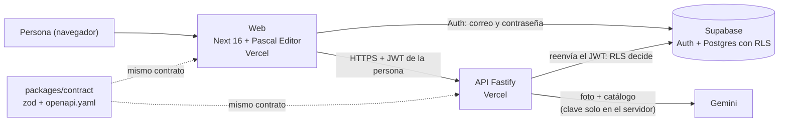

# Madori

**Diseñador de interiores 2D y 3D para viviendas y comercios.**

- **Web:** https://madori-web-opal.vercel.app
- **API:** https://madori-api.vercel.app (`/health` responde `{"status":"ok"}`)
- **Repositorio:** https://github.com/SilvertK164/interiores-3d

Trabajo de **Silvert Quispe** y **Victoria Villalba**, hecho entre los dos: TP final de IISAIA (FIUBA).

## El nombre

*Madori* (間取り) es la palabra japonesa para el **plano de una vivienda**, la distribución de sus ambientes. Es lo que hace la aplicación. El logotipo dibuja la "o" como una ventana con un sol adentro. Marca, paleta y tipografías en [`docs/nombre-y-marca.md`](docs/nombre-y-marca.md).

## Qué hace

- **Plantillas** de vivienda (loft de doble altura) y de comercio (concept store de dos niveles, café con terraza y supermercado de barrio), o un proyecto en blanco.
- **Editor 2D y 3D** con [Pascal Editor](https://github.com/pascalorg/editor): modos Ver y Editar, vista 2D, 3D o ambas, recorrido en primera persona.
- **Niveles y escaleras** (recta, curva y caracol), muros, aberturas, ambientes, pisos y cielorrasos.
- **Estantes y gabinetes paramétricos** (4 estilos de estante y 9 módulos de gabinete), catálogo de muebles con nombre en castellano y 114 materiales.
- **Exportar el plano en PDF:** hoja A4 o A3 por planta, escala 1:25, 1:50 o 1:100, norte, escala gráfica y cajetín con el logotipo. Modo **Papel** (blanco y negro) o **Color**. Incluye hojas isométricas.
- **Exportar una imagen 3D** del proyecto, en color o en blanco y negro.
- **Escena desde una foto:** subes la foto de un ambiente y Gemini arma el ambiente (medidas, puertas, ventanas, muebles) y la cámara desde donde se tomó la foto. Antes de crear el proyecto ves una vista previa desde arriba.
- **Muebles desde una foto:** dentro del editor, agrega al proyecto los muebles que reconoce en una foto, en un solo paso que se deshace de una vez.
- **Cuentas** con correo y contraseña, recuperar la contraseña, **guardado automático** y eliminar proyectos desde su tarjeta.

## Cómo se usa (para quien evalúa)

1. **Entra a la web y crea una cuenta** (nombre, correo y contraseña de 8 o más caracteres; no hay correo que confirmar).
2. **Crea un proyecto desde una plantilla** (por ejemplo el Loft). Muévete en 2D y 3D, agrega un mueble y espera el guardado automático: si recargas, el proyecto sigue ahí.
3. **Exporta y prueba la foto:** en el editor, **Más → Exportar plano** descarga el PDF; en **Mis proyectos**, **Escena desde una foto → Probar con un ejemplo** arma un ambiente sin gastar cuota de Gemini.

## Stack

| Capa | Tecnologías |
|---|---|
| Web | Next 16, React 19, Tailwind 4, Pascal Editor 1.0.3 (parcheado con `pnpm patch`), three.js |
| API | Fastify 5, contrato en zod y `openapi.yaml` verificado contra el código |
| Datos | Supabase: Postgres con RLS, Auth (correo y contraseña) |
| Análisis de fotos | Gemini, llamado solo desde la API |
| Despliegue | Vercel (dos proyectos: web y API) |
| Herramientas | pnpm 11 (monorepo), Vitest, Playwright, Biome, TypeScript |
| Videos | HyperFrames (HeyGen), en `video/` |

## Arquitectura



La web nunca habla con Gemini: manda la foto a `POST /v1/analyze-room`, la API la valida, llama a Gemini y devuelve un plano en metros que la web convierte en una escena de Pascal. Solo `apps/web/src/editor/` conoce a Pascal (lo vigila `tests/boundaries.test.ts`).

## Estructura de carpetas

```
apps/web/          Next 16: páginas (app/), editor y puente con Pascal (src/editor/), lógica pura (src/lib/), pruebas (test/, e2e/)
apps/api/          Fastify: rutas, acceso a Supabase, análisis de fotos (src/analyze-room/), openapi.yaml, función de Vercel (api/)
packages/contract/ esquemas zod compartidos por la web y la API
supabase/          migraciones SQL (RLS y límites) y pruebas de RLS contra la base local
patches/           parches de pnpm sobre Pascal Editor, su visor y drei
scripts/           entorno local y de nube (db:env, db:env:cloud), cuentas de prueba, regeneración de parches
tests/             pruebas de la raíz: frontera de Pascal, migraciones, entorno y configuración de Vercel
docs/              estado, specs y planes (superpowers/), diseño, seguridad y nube
design/            capturas de Pascal usadas en el diseño (el archivo .pen no se versiona)
video/             videos de presentación (proyecto aparte, con su propio package.json)
```

## Cómo correrlo

Requisitos: Node 22 y pnpm 11 (Corepack). La ruta principal usa un proyecto de Supabase en la nube; no necesitas Docker.

```bash
pnpm install
cp .env.cloud.example .env.cloud     # reemplaza SUPABASE_URL y SUPABASE_ANON_KEY (clave pública) por los de tu proyecto
pnpm db:env:cloud                    # valida los valores y escribe apps/api/.env y apps/web/.env.local
pnpm --filter @interiores/api dev    # http://localhost:3001
pnpm --filter @interiores/web dev    # http://localhost:3000
```

Las migraciones de `supabase/migrations/` se aplican al proyecto con la CLI de Supabase y las claves se piden por un canal privado, nunca al repositorio: la guía completa está en [`docs/nube.md`](docs/nube.md). Para probar el análisis de fotos con Gemini real agrega `GEMINI_API_KEY` a `apps/api/.env` (sin ella la API arranca y el análisis responde 503).

*Opción avanzada:* con Docker Desktop, `pnpm db:start` y `pnpm db:env` levantan Supabase local; es lo que necesitan las pruebas de RLS y las de navegador.

## Pruebas

`pnpm verify` corre, en orden, lint (Biome), compilación, tipos y pruebas de todo el monorepo. Necesita Supabase local (`pnpm db:start`) para las pruebas de RLS.

| Qué | Pruebas |
|---|---|
| `packages/contract` (esquemas) | 76 |
| `apps/api` (rutas, Gemini simulado, errores, `openapi.yaml`) | 228 |
| `apps/web` (lógica pura, componentes, exportación, plantillas) | 1491 |
| `supabase/tests` (RLS con dos usuarios, límites, cupo de análisis) | 44 |
| Raíz (frontera de Pascal, migraciones, entorno, Vercel) | 80 |
| **Total de `pnpm verify`** | **1919 pruebas, 0 fallos** (medido el 2026-10-13, con lint, compilación y tipos en verde) |

Además hay 183 pruebas de navegador real con Playwright (`pnpm --filter @interiores/web e2e`, contra Supabase local); no forman parte de `verify`. El PDF se comprueba con el archivo real: un muro de 5 m mide 100 mm en la hoja a 1:50.

## Seguridad

- **RLS en todas las tablas:** la API reenvía el JWT de la persona a Supabase, así que la base decide quién ve qué. La clave `service_role` solo existe en las pruebas.
- **Límites repetidos en la base:** escena de 4 MiB como máximo, nombre de 1 a 80 caracteres, 50 proyectos por persona y **10 análisis de foto por hora**, aplicado por un disparador para que dos pedidos simultáneos no lo pasen.
- **Bloqueo optimista** (`If-Match` y `409`): dos pestañas no se pisan.
- **Cabeceras:** `nosniff`, `X-Frame-Options: DENY`, HSTS, `Referrer-Policy`, `Permissions-Policy` y CSP en la web; la API además responde `no-store`. CORS cerrado por defecto: solo los orígenes de `CORS_ORIGINS`.
- **La clave de Gemini vive solo en el servidor** (variable sensible de Vercel). La foto no se guarda ni se registra; el aviso de privacidad (el nivel gratuito de Google puede usar lo que se envía) está en el diálogo.
- Errores en castellano y sin detalles internos. Revisión completa en [`docs/seguridad-revision.md`](docs/seguridad-revision.md).

## Flujo de trabajo

Spec → aprobación de las dos personas → plan → rama `feature/*` → implementación con TDD (el test se ve en rojo antes del verde) → revisión cruzada en el PR con la salida real de `pnpm verify`. Hay 4 specs y 4 planes en [`docs/superpowers/`](docs/superpowers/), y las decisiones y sorpresas quedan en [`docs/ESTADO.md`](docs/ESTADO.md) y [`docs/bitacora.md`](docs/bitacora.md). Cómo nos repartimos las ramas y los PR: [`docs/colaboracion.md`](docs/colaboracion.md).

## Documentación

Empieza por [`docs/ESTADO.md`](docs/ESTADO.md) (decisiones, hecho, pendiente). El índice de todo lo demás está en [`docs/README.md`](docs/README.md): análisis de las clases, specs y planes, inventario de Pascal, seguridad, nube y despliegue, diseño y marca.

## Videos

Dos videos de presentación (teaser de 30 s y explicativo de unos 3 minutos) hechos con HyperFrames en [`video/`](video/README.md), con su guion. Los `.mp4` no se versionan: se generan con `npm run teaser` y `npm run explicativo`.

## Créditos y licencias

- **Pascal Editor** (MIT, © Pascal Group Inc.): código vía npm y assets copiados de su repositorio (`apps/web/public/`, con su `pascal-LICENSE.txt`). Las texturas que el repositorio no trae se piden al CDN de Pascal.
- **DM Sans** y **Fraunces** (SIL OFL 1.1), **PDF.js** (Apache 2.0) y **lucide-react** (ISC).
- **Foto de ejemplo del salón** (`apps/web/public/examples/salon.jpg`): origen y licencia **por confirmar**.
- El detalle de cada aviso está en [`THIRD_PARTY_NOTICES.md`](THIRD_PARTY_NOTICES.md). El código propio no declara licencia: es un trabajo académico.
